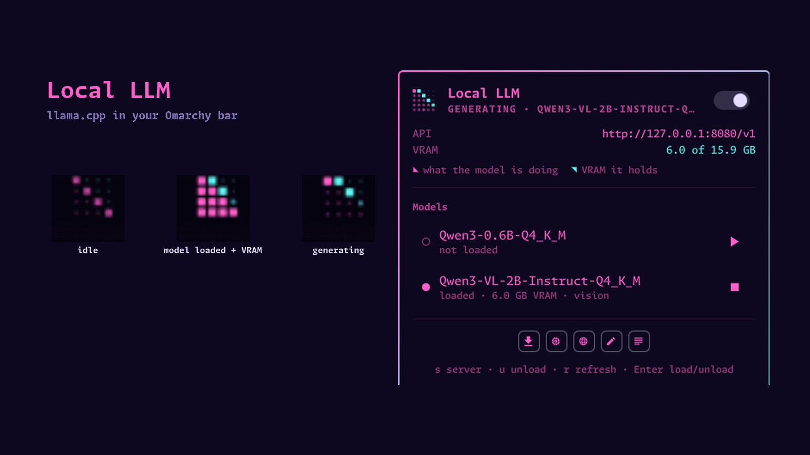

# Local LLM for Omarchy

Run local language models with [llama.cpp](https://github.com/ggml-org/llama.cpp) from your Omarchy bar.



- **One server, every model.** A single `llama-server` in router mode serves every GGUF model you've downloaded through an OpenAI-compatible API at `http://127.0.0.1:8080/v1`. A model loads the first time a request names it.
- **Easy on your GPU.** One model is kept in VRAM at a time, and its weights are freed after 10 minutes idle. Right-click the bar icon to unload it immediately.
- **Models from Hugging Face.** The Pull button searches Hugging Face, lists the quantizations of the repo you pick with a note on which ones fit your VRAM, and downloads your choice. Vision models get their `mmproj` file automatically.
- **Works with llmfit.** Models downloaded from [llmfit](https://github.com/AlexsJones/llmfit) land in the same folder and show up on their own.

## The icon

The bar icon is a small matrix split on its diagonal.

| Part | Shows | States |
|---|---|---|
| Lower triangle (bar color) | What the model is doing, drawn as a transformer's causal attention mask | faint dots: server stopped · diagonal only: idle · cells filling: loading · full triangle: ready · shrunken points: asleep · a row walking down with flickering cells: generating |
| Upper triangle (second theme color) | How much of your GPU memory the model holds | fills outward from the diagonal; turns red when the whole card is over 92% full |

The second color is `ch2` from the theme's `scope.json` if it ships one, otherwise the theme's cyan, then blue, then accent.

Left-click opens the panel, right-click unloads the loaded model, middle-click opens the llama.cpp web UI.

## Requirements

- Omarchy 4 (the Quickshell-based shell)
- `llama-server` from llama.cpp: `sudo pacman -S llama-cpp`, plus a GPU backend such as `ggml-cuda` (NVIDIA) or `ggml-vulkan`
- `curl`, `systemd` (user services), `python` 3.10+
- For downloading models: `sudo pacman -S python-huggingface-hub python-hf-xet fzf`
- Optional: `nvidia-smi` for the VRAM gauge (without it the gauge stays empty), `gum` for a nicer search prompt, `llmfit` for hardware-aware model recommendations

## Install

```sh
omarchy plugin add https://github.com/0w3n-N/omarchy-local-llm.git --enable
```

Then open the panel and flip the switch. The first time, this runs **setup** in a terminal. Setup:

1. checks that `llama-server` and `curl` are installed, and tells you what to install if not;
2. writes three systemd **user** units to `~/.config/systemd/user/`: `local-llm.service` (the server), and `local-llm-reload.path` / `.service` (rescan when models or presets change);
3. creates `~/.config/local-llm/presets.ini` if it doesn't exist;
4. links `~/.local/bin/llm` to the bundled command-line tool, if nothing is there already;
5. enables and starts the service.

Setup needs no `sudo`. It never replaces an existing file that differs without asking first. You can also run it yourself: `~/.config/omarchy/plugins/io.github.0w3n-n.local-llm/bin/llm setup`.

The service is named `local-llm` on purpose: Arch's `llama-cpp` package ships its own `llama-server.service`, and this plugin leaves that one alone.

## Use

Panel buttons, left to right: pull a model, open llmfit, open the web UI, edit presets, show server logs. Click a model to load or unload it. Keyboard: arrows and Enter, `s` server, `u` unload, `p` pull, `f` llmfit, `w` web UI, `e` presets, `l` logs, `r` refresh.

The same things from a terminal:

```
llm search qwen3 coder            find GGUF repos on Hugging Face
llm quants <user/repo>            list quantizations with size and fit
llm pull                          interactive: search, pick repo, pick quant
llm pull <user/repo>[:QUANT]      download directly
llm ls | rm <model> | unload      list, delete, free VRAM now
llm serve | stop | restart | status | logs
llm edit                          per-model settings
```

Point any OpenAI-compatible client at `http://127.0.0.1:8080/v1` and use a model name from `llm ls`. The server listens on localhost only.

### Settings

`~/.config/local-llm/presets.ini` holds llama-server flags. The `[*]` section applies to every model; a section named after a model overrides it. The defaults free an idle model after 10 minutes (`sleep-idle-seconds = 600`) and cap context at 32k tokens (`ctx-size = 32768`), because without a cap llama.cpp allocates each model's full trained context and can fill your VRAM. Raise it per model when you need more. Saving the file applies it; a model that is already loaded picks it up on its next load.

Models live in `~/.cache/llmfit/models` (set `LLM_MODELS_DIR` to change where the `llm` command looks; the service uses the default path).

The widget's own settings are the server port (default 8080) and how often it checks the server while the panel is closed (default 5 seconds).

## What the plugin runs

Plugins run unsandboxed inside the Omarchy shell, so here is everything this one executes:

- `curl` to `127.0.0.1` only (model list, load, unload)
- `systemctl --user` to start, stop, and inspect `local-llm.service`
- `nvidia-smi` and `cat /proc/<pid>/stat` for the VRAM gauge and the "generating" state, only while a model is loaded
- the bundled `bin/llm` in a terminal, when you press a button that needs it

It makes no network requests of its own. `llm search` and `llm pull` talk to huggingface.co when you run them.

## Remove

```sh
llm uninstall                 # stops the service, removes the three units and the llm link
omarchy plugin remove io.github.0w3n-n.local-llm
```

Run `llm uninstall` first, since it lives inside the plugin folder. It keeps your downloaded models (`~/.cache/llmfit/models`) and your settings (`~/.config/local-llm`). Delete those two folders by hand if you want them gone.

## Troubleshooting

- **"Not set up yet"**: flip the switch in the panel, or run `llm setup`.
- **The service fails to start**: `llm logs`. The usual causes are a missing GPU backend package or another program on port 8080.
- **A model is slow or only partly on the GPU**: it doesn't fit in VRAM alongside its context. Pick a smaller quantization (`llm quants <repo>`) or lower `ctx-size` for that model.
- **A new download doesn't appear**: `llm ls` forces a rescan.

## License

MIT. See [LICENSE](LICENSE).
